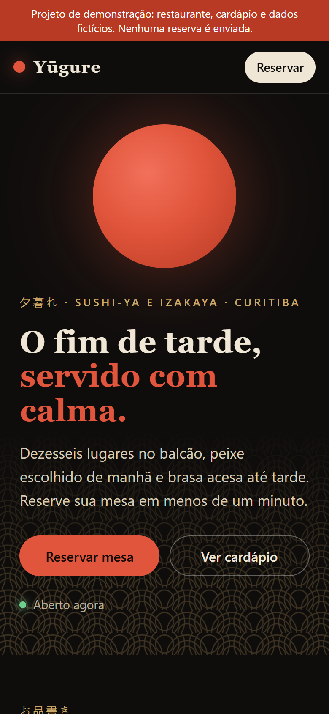
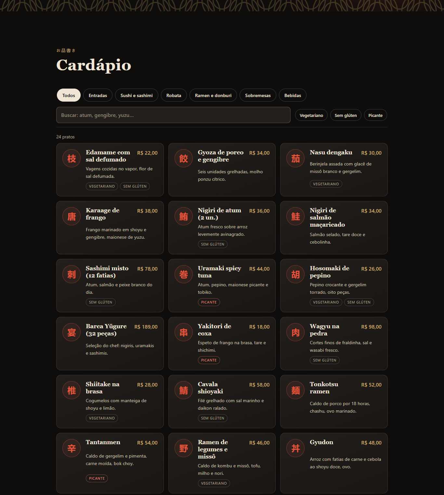
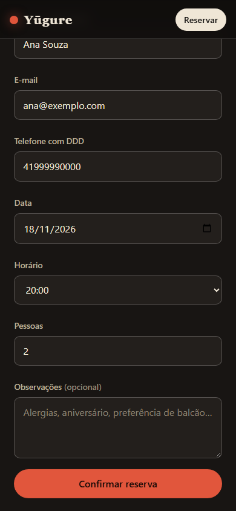

# Yūgure Sushi-ya

Demo website for a fictional Japanese restaurant in Curitiba, Brazil: filterable menu, gallery, opening hours with a live "open now" status, and a validated reservation form.

**Live demo:** https://alissonlittig.github.io/yugure-sushi/

> Portfolio demo. The restaurant, address, phone and prices are fictional. No reservation is sent anywhere; the last one is kept only in the browser's `localStorage`.

| Desktop | Mobile (390px) |
|---|---|
|  |  |
|  |  |

## Features

- **Menu**: 24 dishes, category chips, dietary filters (vegetarian, gluten-free, spicy) combined with accent-insensitive text search.
- **Reservations**: field validation with inline, accessible errors (`aria-invalid`, focus on first error); closed days (Mondays), per-shift time slots every 30 min (last seating 1h before closing), 1–8 guests, 60-day horizon, no past times today.
- **Hours**: weekly table, today highlighted, "open now" indicator in the hero.
- **Gallery**: inline SVG illustrations, no image weight.
- **Accessibility and performance**: skip link, visible focus, AA contrast, reduced-motion support, no horizontal scroll at 390px. Lighthouse (mobile): Performance 99, Accessibility 100, Best Practices 100, SEO 100.

## Stack

Plain HTML, CSS and ES modules. No runtime dependencies, no framework.

```
index.html, styles.css
src/menu.js      menu data + filter logic
src/booking.js   opening hours, slots, validation
src/main.js      DOM wiring
tests/           node:test unit tests (validation, slots, filters)
```

## Run

```bash
npm test          # 10 unit tests, Node 20+
npm run build     # copies the site to dist/
python -m http.server -d .   # ES modules need http://, not file://
```

CI (`.github/workflows/ci.yml`) runs tests, builds and deploys to GitHub Pages on every push to `main`.

## License

MIT. Fictional content; do not use as real restaurant data.
